  

# 🚀 Awesome Lead Management & Nurturing

**Curated Directory of Enterprise SaaS Solutions & Self-Hosted Open-Source Platforms** 🎯  
*Supercharge B2B/B2C conversions with automated lead qualification, multi-touch nurture funnels, and predictive scoring engines.* 📈

**Last updated: November 2026** 📅

---

## 📖 Overview

**Lead Management & Nurturing** is the backbone of modern revenue operations (RevOps). It unites lead capture, data enrichment, engagement-based lead scoring, segmentation, and automated drip sequences across email, SMS, and web channels—turning cold prospects into sales-ready pipeline without manual bottlenecks.

This repository tracks top **cloud SaaS platforms** and powerful **open-source CRM & marketing automation projects**, giving RevOps professionals, growth hackers, and software engineers an unbiased landscape to build or buy their sales pipeline tech stack.

---

## 📊 Sector Overview & Market Dynamics

The global **Lead Management & Marketing Automation Software Market** is estimated at **$12.5 Billion in 2026**, growing at a 13.8% CAGR toward $24.8 Billion by 2032. 

The sector exhibits **moderate fragmentation with a consolidated enterprise core**: mega-platforms (Salesforce, Adobe, HubSpot) dominate Fortune 500 multi-channel orchestration with high vendor lock-in, while high-velocity SMBs and mid-market teams increasingly adopt modular, developer-friendly CRMs (Pipedrive, ActiveCampaign) or data-sovereign open-source solutions (Mautic, Helio, Twenty) for self-hosting and zero per-contact fees.

---

## 📑 Table of Contents

- [☁️ SaaS & Hosted Platforms](#️-saashosted-platforms)
- [💻 Open-Source GitHub Projects](#-open-source-github-projects)
- [📈 Star History](#-star-history)
- [🤝 How to Contribute](#-how-to-contribute)
- [💖 Support & Sponsor](#-support--sponsor)
- [⚠️ Disclaimer](#️-disclaimer)

---

## ☁️ SaaS & Hosted Platforms

> Sorted in descending order by company scale (**Market Cap / Enterprise Valuation / Annual Revenue**).

| Platform | Company Valuation / Revenue | Starting Price | Free Tier / Free Trial Limits | Key Lead Management & Nurturing Features |
| :--- | :--- | :--- | :--- | :--- |
| **[Salesforce Marketing Cloud](https://www.salesforce.com/)** | ~$280B Market Cap (~$38B ARR) | $1,250/mo (Marketing Cloud Growth) | 30-day free trial (sandbox environment with sample data & limited sends) | Enterprise Journey Builder, Einstein 1 predictive lead scoring, omni-channel automated paths, deep CRM integration. |
| **[Adobe Marketo Engage](https://business.adobe.com/)** | ~$220B Adobe Market Cap (~$21B ARR) | $895/mo (Growth tier estimate) | 14-day guided sandbox trial (demo instance with synthetic lead database) | Enterprise lead scoring models, complex account-based marketing (ABM), multi-touch attribution, agentic AI triggers. |
| **[HubSpot Lead Management](https://www.hubspot.com/)** | ~$35B Market Cap (~$2.6B ARR) | $15/user/mo (Starter Customer Platform) | Free forever plan: 1,000 contacts, 5 active email lists, basic forms & landing pages (14-day trial for Professional) | Native lead capture, dynamic score degradation, multi-branch drip sequences, bi-directional pipeline sync. |
| **[Zoho CRM](https://www.zoho.com/crm/)** | ~$1.4B ARR (~$15B Private Est.) | $14/user/mo (Standard billed annually) | Free forever plan: up to 3 users, 5,000 lead records, standard email templates (15-day trial on Ultimate) | Zia AI predictive lead win probability, lead routing rules, blueprint visual workflow designer, email cadence alerts. |
| **[ActiveCampaign](https://www.activecampaign.com/)** | ~$3B Valuation (~$250M ARR) | $15/mo (Starter tier, 1,000 contacts) | 14-day free trial: up to 100 contacts and 100 email sends (no credit card required) | Behavior-triggered automations, engagement score degradation, visual sequence designer, predictive send times. |
| **[Pipedrive](https://www.pipedrive.com/)** | ~$1.5B Valuation (~$180M ARR) | $14/user/mo (Lite billed annually) | 14-day free trial: full access to Advanced plan with unlimited pipeline creation (no credit card required) | Activity-based lead tracking, LeadBooster chatbot and web forms add-on, customizable visual pipelines. |
| **[Keap](https://keap.com/)** | ~$80M ARR (~$500M Est. Value) | $249/mo (Pro tier, includes 1,500 contacts) | 14-day free trial: includes 500 test contacts and full access to Pro campaign builder | Visual campaign sequence builder, automated lead qualification surveys, integrated appointment scheduling. |
| **[Ortto](https://ortto.com/)** | ~$25M ARR (~$200M Private Est.) | $99/mo (Professional tier, 5,000 contacts) | 14-day free trial: up to 5,000 contacts and 5,000 emails with journey builder enabled | Unified CDP + lead scoring engine, multi-channel journey mapping (Email, SMS, Webhooks), product-led growth analytics. |
| **[LeadSquared](https://www.leadsquared.com/)** | ~$1B Valuation (Unicorn, ~$40M ARR) | $25/user/mo (Lite tier billed annually) | 14-day free trial: includes up to 500 leads with access to core sales execution workflows | High-velocity lead distribution rules, omnichannel capture, granular activity scoring, mobile lead tracking. |
| **[SharpSpring](https://sharpspring.com/)** | Constant Contact Subsidiary (~$50M ARR) | $449/mo (includes 1,000 contacts) | 14-day free trial: access to full automation suite with guided onboarding specialist | Dynamic behavioral lead scoring, multi-variable email drip sequences, visitor ID tracking, built-in sales CRM. |

---

## 💻 Open-Source GitHub Projects

> Open-source lead management and CRM engines give development and marketing teams absolute data privacy, self-hosted deployment (Docker / K8s), and zero per-contact fees.  
> Sorted in descending order by **GitHub Star Count**.

| Project & Repository | GitHub Stars | License | Core Lead Management & Nurturing Capabilities |
| :--- | :--- | :--- | :--- |
| **[Twenty](https://github.com/twentyhq/twenty)** |  | AGPL-3.0 | Modern TypeScript CRM designed as an extensible Notion/HubSpot alternative. Features visual custom pipelines, lead routing, task automation, PostgreSQL/GraphQL backend, and rich API hooks. |
| **[Chatwoot](https://github.com/chatwoot/chatwoot)** |  | MIT | Real-time conversational customer engagement platform. Integrates live-chat lead qualification bots, multi-channel inbox (WhatsApp, Email, Telegram), automated campaign nudges, and CRM hooks. |
| **[ERPNext](https://github.com/frappe/erpnext)** |  | GPL-3.0 | Comprehensive Python/Frappe enterprise suite featuring an integrated CRM module with automatic lead capture, email campaign sequences, opportunity stages, and lead conversion pipelines. |
| **[Krayin CRM](https://github.com/krayin/laravel-crm)** |  | MIT | Modular Laravel-based open-source CRM with visual lead and deal Kanban boards, contact stages, email trigger actions, and custom attribute builders tailored for agile sales teams. |
| **[Mautic](https://github.com/mautic/mautic)** |  | GPL-3.0 | The de facto open-source marketing automation platform. Features rule-based lead scoring (points, triggers), drag-and-drop campaign journeys, dynamic landing pages, email A/B testing, and GDPR consent management. |
| **[SuiteCRM](https://github.com/salesagility/SuiteCRM)** |  | AGPL-3.0 | Enterprise-grade self-hosted CRM (SugarCRM fork) with end-to-end lead lifecycle tracking, automated workflow engines, email marketing campaigns, and granular role permissions. |
| **[EspoCRM](https://github.com/espocrm/espocrm)** |  | AGPL-3.0 | Lightweight and fast single-page CRM application with customizable lead conversion flows, automated drip campaigns, sales stages, and REST API integrations. |
| **[CiviCRM Core](https://github.com/civicrm/civicrm-core)** |  | AGPL-3.0 | Purpose-built constituent relationship management for non-profits and civic organizations. Features donor/supporter lead segmentation, automated fundraising follow-ups, and email tracking. |
| **[Liberu CRM](https://github.com/liberusoftware/crm-laravel)** |  | Open-Source | Laravel-based multi-tenant CRM featuring integrated lead scoring, customizable sales pipelines, email tracking, landing page capture forms, and automated trigger rules. |
| **[Horilla CRM](https://github.com/horilla/horilla-crm)** |  | LGPL-2.1+ | Modern Django/SvelteKit HR & CRM software equipped with a configurable lead-scoring rules engine with per-factor weights, pipeline stages, and REST API endpoints. |
| **[Helio](https://github.com/achref-soua/helio)** |  | AGPL-3.0 | AI-native growth platform featuring visual nested segmentation, Temporal-backed durable nurture journeys, predictive churn/lead scoring, and an MCP server for AI agent automation. |

---

## 📈 Star History

---

## 🤝 How to Contribute

We welcome contributions from the community to keep this list comprehensive and up-to-date! 🌟

1. Fork this repository 🍴
2. Create your feature branch (`git checkout -b feature/add-new-tool`)
3. Add the project or SaaS platform following the table format (include transparent pricing, trial terms, or star badges)
4. Submit a Pull Request with a clear description of why the tool belongs here 🚀

---

## 💖 Support & Sponsor

Thank you for exploring and using this curated resource! If you find this repository valuable:
- ⭐ **Star** this repository to help others discover it!
- 🍴 **Fork** it and build upon the curated insights!
- 📢 **Share** it with fellow marketers, developers, and RevOps engineers!
- ☕ **Buy a Coffee & Support**: Sponsor the ongoing maintenance and curation via the [GitHub Sponsors Dashboard](https://github.com/sponsors/ishandutta2007).

---

## ⚠️ Disclaimer

- 📌 This is a **community-curated directory** intended for informational and educational purposes — listings do not constitute commercial endorsements.
- 🔒 Lead management systems handling prospective customer information must comply with international privacy standards (GDPR, CCPA, CAN-SPAM). Self-hosted platforms place the complete responsibility for server security, email deliverability, and data integrity on the operator.
- 📜 Always verify software license terms prior to production or enterprise commercial deployment.
